# Facebook / Instagram Campaign Brief — Daily Mind Challenge

A brief written to hand to an external marketing agency for a paid social (Facebook/Instagram)
campaign. Self-contained — every image referenced here lives in `docs/assets/campaign/` alongside
this file, so the whole `docs/` folder (or just this file plus that one subfolder) can be shared
externally with no access to the rest of the codebase needed.

- **Site**: `dailymindchallenge.com`
- **Contact**: `support@dailymindchallenge.com`
- **Platform**: Facebook & Instagram Ads
- **Status**: ready to brief an agency

---

## 1. What it is

Daily Mind Challenge is a free, browser-based puzzle site built around a daily habit: six
puzzle formats — four well-known ones (Wordle, Sudoku, Word Search, Connections) plus two of our own:
Quilt, a picture-reveal logic puzzle, and Pounce, a cat logic puzzle — each refreshed with a new challenge once a day. No app download, no install, and no signup wall: anyone can start
playing in one tap as a **guest**. An optional free account adds streak tracking, a daily login
bonus, and the ability to create and share custom challenges.

## 2. The six games, mode by mode

Every game shares the same three-mode shape (**Daily Challenge**, a replay mode, and
**Tournament**), which is itself a useful, repeatable creative hook — "pick your game, then pick
how you want to play it."

### Wordle 🟩

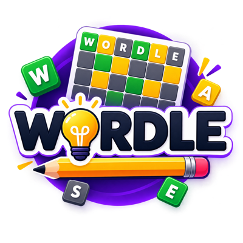

| Mode | What it is |
|---|---|
| **Daily Challenge** | One 5-letter word a day, identical for every player. Guess it in 6 tries; tiles turn green/yellow/gray after each guess, exactly like the original Wordle. Miss it and the word stays hidden -- try again after a 1-hour cooldown (unlimited retries until solved or the day ends). |
| **Tournaments** | An admin-curated run of several words back to back, each under a time limit. Fail one word and the whole run resets to word 1 — no partial credit, high stakes, built for players who want a real challenge. Full completion pays out a lump-sum bonus. |
| **Challenge a Friend** | A registered player picks their own 5-letter word, gets a shareable link, and sends it to anyone. The recipient (guest or registered, no account needed) gets one attempt. The creator earns a reward for every distinct person who tries their challenge. This is the built-in viral loop — a real player-to-player share mechanic already live in the product, not something a campaign would need to invent. |

### Sudoku 🔢

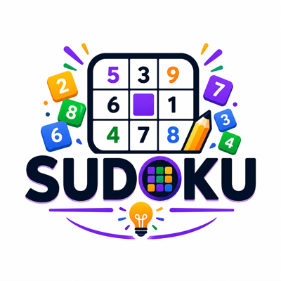

| Mode | What it is |
|---|---|
| **Daily Challenge** | One 9×9 puzzle a day, identical for every player. Tap a cell, tap a number (or type it on a keyboard) to fill it in. |
| **Classic** | Pick a difficulty — Easy, Medium, or Hard — and get a random puzzle from that pool. Unlimited replays, any time, no daily limit. |
| **Tournament** | A curated run of puzzles under a per-puzzle time limit and error allowance. Unlike Wordle Tournaments, failing a puzzle here doesn't reset the run — it banks a smaller reward and moves straight to the next puzzle, so a single mistake doesn't cost the whole session. A completion bonus pays out once every puzzle in the run has been attempted. |

### Word Search 🔍

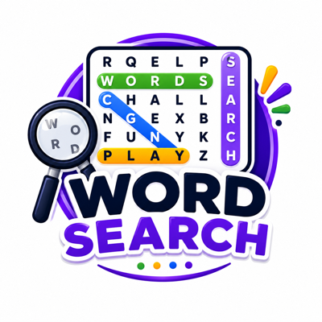

| Mode | What it is |
|---|---|
| **Daily Challenge** | One hidden-word grid a day, identical for every player. Click/tap a letter and drag in a straight line to the matching word's other end. |
| **Classic** | Pick a difficulty (Easy/Medium/Hard, each with its own grid size and word count) and get a random puzzle, with a freshly shuffled grid layout on every replay — no memorizing a fixed layout. |
| **Tournament** | Same forgiving shape as Sudoku's — a run of puzzles under a time limit, a failed puzzle banks a smaller reward and moves on rather than ending the run, plus a live running score shown throughout and a completion bonus at the end. |

### Connections 🟪

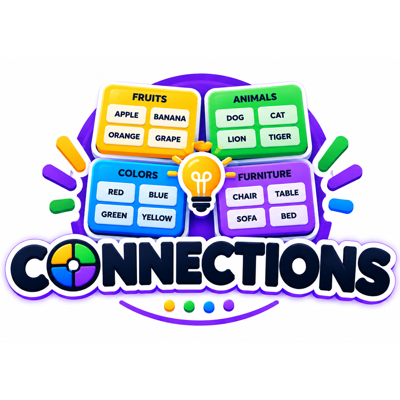

The newest addition to the lineup — a word-grouping puzzle in the style of the NYT's own
Connections: find four hidden groups of four related words, from a 16-word grid, before running
out of guesses.

| Mode | What it is |
|---|---|
| **Daily Challenge** | One 16-word grid a day, identical for every player. Find all four groups of four before 4 wrong guesses. Miss it and the answers stay hidden -- try again after a 1-hour cooldown (unlimited retries until solved or the day ends), same forgiving shape as Wordle's Daily Challenge. |
| **Classic** | Pick a difficulty — Easy, Medium, or Hard — and get a random puzzle from that pool. Unlimited replays, any time, no daily limit. |
| **Tournament** | A curated run of puzzles under a per-puzzle time limit. Failing a puzzle resets the whole run back to puzzle 1 — no partial credit, same high-stakes shape as Wordle Tournaments. Full completion pays out a lump-sum bonus. |

### Quilt 🧵

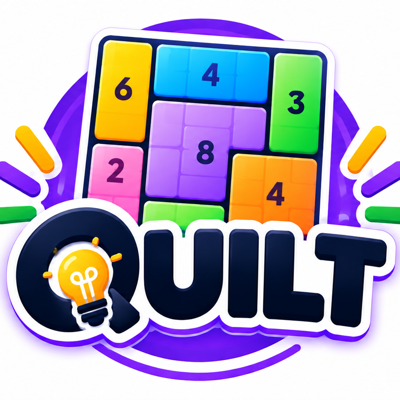

The newest game, and the first original one: a Shikaku-style logic puzzle with a twist. Players
drag rectangles over a grid of numbers so each rectangle holds exactly one number equal to its area.
While they play the pieces are plain fabric; the moment the board is finished, every piece is dyed
its real colour and **a hidden pixel-art picture appears**. Strong visual hook for creative — the
"before" (a grid of numbers) and the "after" (a picture) make a natural two-frame ad or carousel.

| Mode | What it is |
|---|---|
| **Daily Challenge** | One picture a day, identical for every player, no way to fail — just a speed bonus and a "Perfect Stitch" bonus for solving without a single undo. The daily share text deliberately hides the picture ("Can you reveal today's picture?"), so friends have to play to see it. |
| **Classic** | Easy 7×7, Medium 10×10 or Hard 14×14 (Hard adds "knots" and shape clues). Unlimited replays, pictures you haven't solved come first. |
| **Patchwork Run** (Tournament) | One big picture cut into timed tiles; the full picture builds up tile by tile as a mosaic. A tile that runs out of time stays grey, so a "perfect patchwork" is a visible, shareable achievement. |

### Pounce 🐾

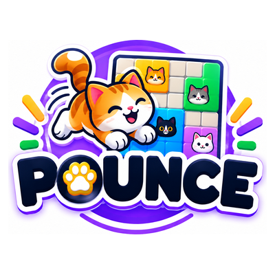

The newest game: a cosy cat logic puzzle with attitude. Each board is a grid of coloured patches,
like cushions on a floor, and the player finds every cat its own nap spot — one cat per row, per
column and per colour patch, and no two cats touching, because these cats don't share. Place a cat
and it **pounces** into its spot; put one in the wrong place and it hisses and hops off. Solve the
board and every cat curls up asleep. Taglines: *"Find the spot. Pounce."* and *"One cat per row.
No cuddling."*

| Mode | What it is |
|---|---|
| **Daily Challenge** | One 8×8 board a day, the same for everyone, no way to fail. Every Daily solved **adopts a named cat** for the player's **Cat Café** collection ("You adopted Biscuit the tabby!") — a gentle reason to come back tomorrow, and a natural "collect them all" angle. |
| **Classic** | Easy 6×6, Medium 8×8 (sleeping dogs block cells), Hard 9×9 (plus pawprint clues). Unlimited replays. |
| **Nine Lives Run** (Tournament) | Five timed boards from 5×5 to 9×9 with nine lives for the whole run; lives left at the end earn a bonus. "How many lives did you keep?" is a ready-made share line. |

Stuck players get a **Whisker Tip** that explains the next step in plain words rather than just
giving away an answer — a friendly, "teaches you to get better" angle for the audience.

## 2b. Progress, rewards and competition

Beyond the puzzles themselves, the product has a full progression layer -- a strong source of
creative angles ("collect them all", "climb the ranks"):

- **121 illustrated achievement badges** -- per-game Expert/Master/Grand Master tiers, Daily/Weekly/Monthly Champion titles (repeat-win tiers up to 100 wins), streak badges (7 to 365 days), and all-games milestones (Perfect Day, Triple Threat, Mind Master, Mind Athlete...). Each unlock also grants bonus XP.
- **XP, Levels and Ranks** -- 1,000 XP per Level; 10 rank tiers from Novice to Legend, each with 10 sub-ranks and its own badge and color.
- **Streaks and Daily Missions** -- play on consecutive days; short daily goals with XP rewards.
- **Public leaderboard** -- Today/Week/Month/Year/All-time, per game or overall; click any player to see their rank card and badges. No login needed to view it.
- **Championships** -- the top scorer of each game each day, week and month is crowned Champion.

## 3. Why this is a good paid-social fit

- **Zero-friction entry.** The ad's landing destination is playable in one tap — no app-store
  detour, no account wall. A much shorter path from click to "aha" than most game/app ads get.
- **Built to be shared already.** Wordle's Challenge a Friend is a real, live player-to-player
  share mechanic — a campaign can lean on and amplify it, not build it from scratch.
- **A daily-habit product.** All six games reset every 24 hours with a streak mechanic — exactly
  the kind of hook that rewards a sustained, always-on campaign over a one-off burst.
- **Proven category.** Daily word/number puzzles are an established, high-engagement habit (see
  Wordle's own rise, and the broader daily-puzzle category). The audience already understands the
  format — the ad's job is introducing this specific site, not the concept.

## 4. Audience

This is squarely the existing daily-word-and-number-puzzle audience — the crowd already playing
Wordle, NYT Games, or a Sudoku app daily. Worth designing creative around:

- **Habitual, not casual.** They already have a puzzle ritual somewhere in their day — commute,
  coffee break, before bed. The pitch is "add this to that ritual," not "discover puzzles."
- **Competitive-with-friends, not competitive-with-strangers.** The leaderboard and Challenge a
  Friend features suggest messaging around besting a specific person, not climbing an anonymous
  global rank.
- **Value variety without switching apps.** A meaningful share of this audience already plays more
  than one puzzle type across separate apps (Wordle *and* a number puzzle *and* a word search
  *and*, increasingly, a NYT Connections-style word-grouping game) — "six in one" is a genuine,
  differentiated pitch to them. Quilt adds something none of those apps have: a puzzle that
  rewards you with a picture; Pounce adds cute, collectible cats to a proven logic format.
- **Price- and friction-sensitive.** Free and no-signup-required are real decision factors for
  this audience, not just nice-to-haves — worth stating plainly in copy rather than implying.

> The above is directional, drawn from the product's own design decisions (guest play, streaks,
> challenge-a-friend), not sourced third-party audience research. Worth validating/refining with
> the agency's own Meta Ads Manager audience insights before finalizing targeting.

## 5. Key messages

In rough priority order — lead with whichever tests best, but don't dilute all of these into one ad:

- **"6-in-1"** — one site, six daily puzzles, stop switching between apps.
- **"Solve it, reveal the picture"** — Quilt's hook; works especially well as a before/after visual.
- **"Find the spot. Pounce."** — Pounce's hook: cats with attitude, and a new cat to adopt every day.
- **"Free, always"** — completely free, no download, no account required to start.
- **"One tap to play"** — from ad click to playing, no signup wall in the way.

The site's own existing tagline, used consistently in its share copy today: *"Play daily Wordle,
Sudoku, Word Search, Connections, Quilt, and Pounce puzzles, earn points, and climb the leaderboard."*

## 6. Voice & tone

Warm, encouraging, a little playful — never smug or hardcore-gamer-coded. The product's own copy
leans on this consistently (its help and FAQ copy stays friendly and encouraging).
Emoji are used naturally in the app's own share messages (🧠 🟩 🔥 👀) — a reasonable cue for how
casual ad copy can go, without tipping into gimmicky.

**Avoid**: intensity/competition-only framing ("dominate," "crush"), anything implying a
real-money or gambling mechanic (there is none), and app-store language ("download," "install") —
this is a website, and that friction-free distinction is part of the pitch.

## 7. Brand assets

All images below are included alongside this document (`docs/assets/campaign/`) — nothing here
requires codebase access.

### Logos

| | |
|---|---|
|  | **Main site logo** — the general "Daily Mind Challenge" mark, not tied to any one game. `logo-header.png` |
|  | **Wordle logo** — full-color game tile art, square format. `tile-wordle.png` |
|  | **Sudoku logo** — full-color game tile art, square format. `tile-sudoku.png` |
|  | **Word Search logo** — full-color game tile art, square format. `tile-wordsearch.png` |
|  | **Connections logo** — full-color game tile art, square format. `tile-connections.png` |
|  | **Quilt logo** — full-color game tile art, square format. `tile-quilt.png` |
|  | **Pounce logo** — full-color game tile art (the ginger mascot pouncing onto a board), square format. `tile-pounce.png` |

### Pre-built share images

Ready-made link-preview images (roughly 1730-1760 × 900-910, exact size varies slightly per game), one general and one per game:

| | |
|---|---|
| 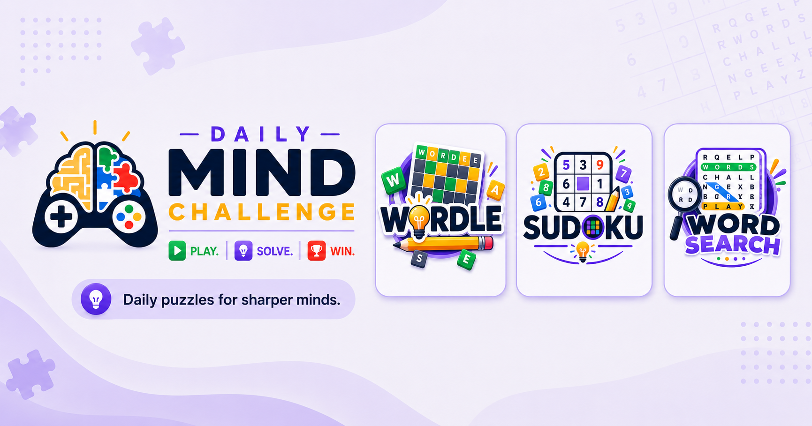 | `fb-share-general.png` |
| 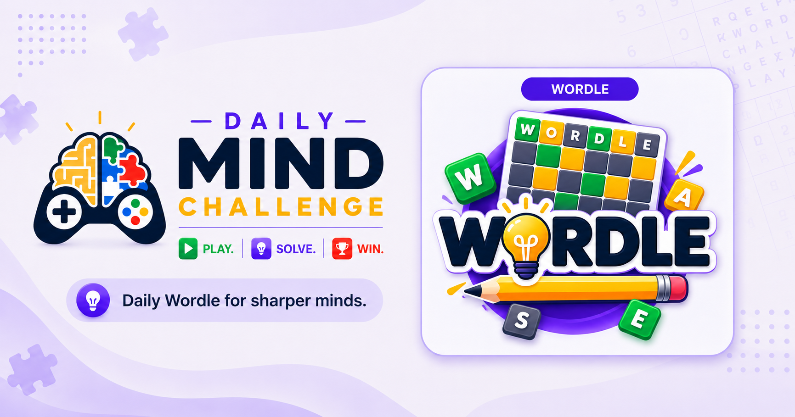 | `fb-share-wordle.png` |
| 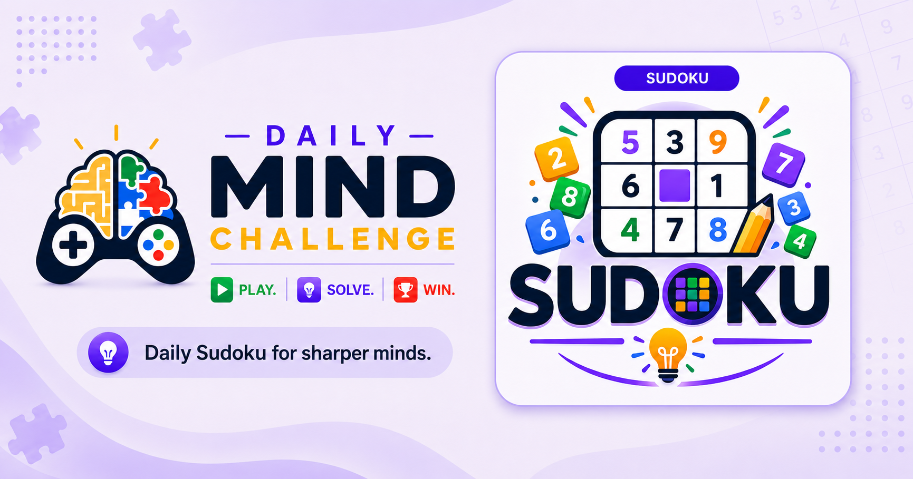 | `fb-share-sudoku.png` |
| 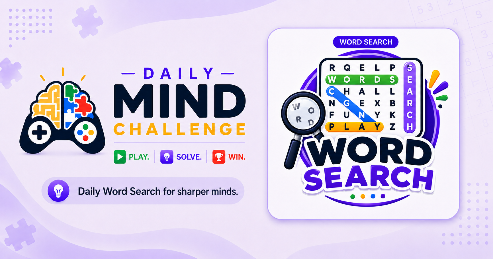 | `fb-share-word-search.png` |
| 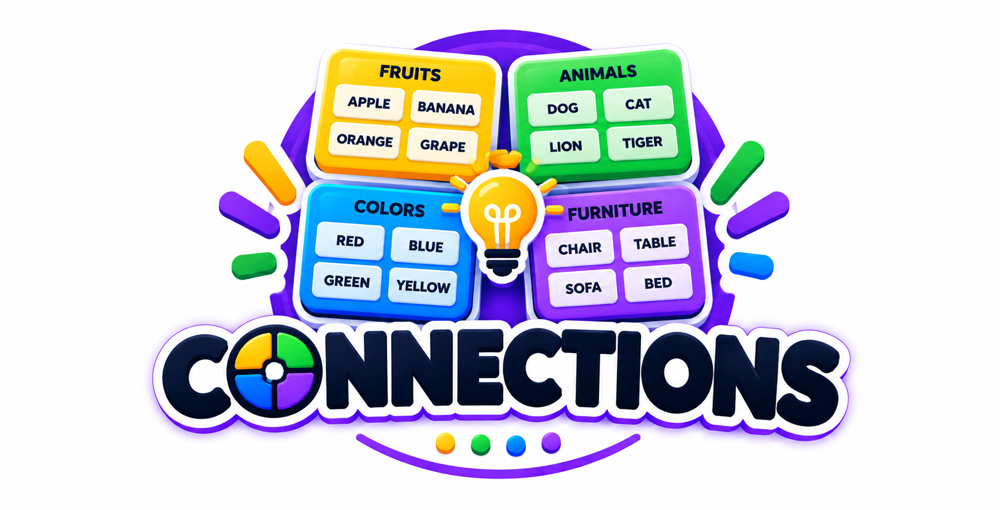 | `fb-share-connections.png` |

Quilt and Pounce don't have purpose-made share images yet (their link previews currently reuse the
logos) — wide (~1.91:1) creative for both is an open item.

### Achievement badge samples

Illustrated badge art (240x240, transparent PNG) -- a small sample; all 121 exist in the codebase and can be provided on request:

| | | | |
|---|---|---|---|
| 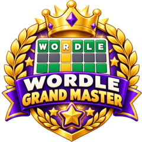 | 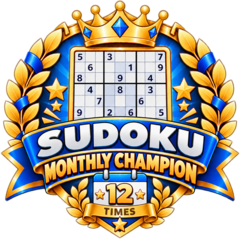 | 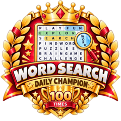 | 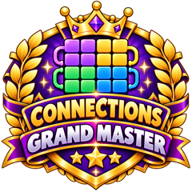 |
| 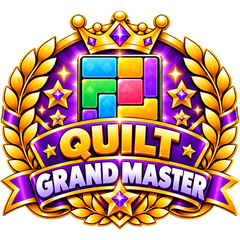 | 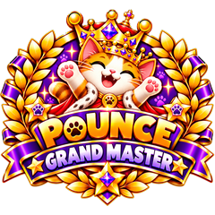 | | |
| 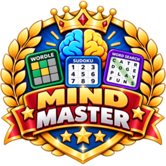 | 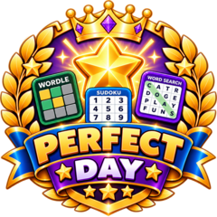 | 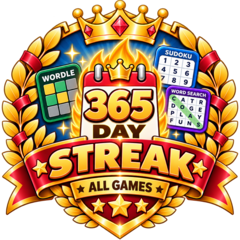 | |

### Brand palette

| Swatch | Role | Hex |
|---|---|---|
| 🟪 | Primary/brand purple | `#534AB7` (dark variant `#3C3489`) |
| 🟨 | Wordle accent gold | `#D8A030` |
| 🟩 | Sudoku accent green | `#1D9E75` |
| 🟧 | Word Search accent rust | `#D85A30` |
| 🟠 | Pounce ginger (with charcoal `#3A3340` and cream `#FBF6EC`) | `#F28C38` |

Connections doesn't have a single accent color the way the other three games do — in-game, its
puzzle groups are color-coded by difficulty (yellow → green → blue → purple, matching the NYT
Connections convention), so its own tile/branding uses that same four-color set rather than one
representative hex. Quilt's tile uses the same multi-colour block set as its puzzle pieces, on
the brand purple. Pounce's brand is warm ginger, charcoal and cream, with a smug ginger cat
mascot (Mochi).

In-app screenshots aren't pre-captured but can be taken directly from the live site on request —
all six games are fully playable at `dailymindchallenge.com`. No video/motion assets exist yet.

The site's existing Facebook Page and Facebook Group are live community channels worth
linking/cross-promoting rather than treating the campaign as the site's only presence.

## 8. Landing destinations

No app-install step — every destination below is the live site itself, playable immediately:

- `dailymindchallenge.com` — home page, all six games
- `dailymindchallenge.com/wordle`
- `dailymindchallenge.com/sudoku`
- `dailymindchallenge.com/wordsearch`
- `dailymindchallenge.com/connections`
- `dailymindchallenge.com/quilt`
- `dailymindchallenge.com/pounce`
- `dailymindchallenge.com/leaderboard` -- public rankings; good for "can you beat this score?" creative

## 8b. Tracking and measurement

- **Meta Pixel is live** on `dailymindchallenge.com` (ID `1883519629480679`). It records page views and enables retargeting and conversion measurement for Meta ads.
- Beyond page views, it also tracks `CompleteRegistration` (a new account signs up), `GuestStarted` (a visitor continues as guest), and `GameCompleted` (any Daily/Classic/Tournament puzzle is finished, tagged by game) — real engagement signals for Meta to optimize ad delivery against, not just traffic.
- It loads **only for visitors who accept cookies**. Visitors who decline are not tracked by the pixel, so retargeting audiences and reported conversions will be smaller than total site traffic. Plan budgets and expectations accordingly.
- Disclosed in the site's privacy policy and cookie notice (both updated 2026-10-03).

## 9. To be defined together

Everything above is enough for an agency to start scoping creative and targeting direction. These
are genuine open decisions, not omissions — resolve them on the kickoff call:

- **Budget & flight dates** — not yet set.
- **Primary KPI** — candidates: site traffic, daily active players, or Facebook Group/Page growth;
  needs a client decision.
- **Geography** — not yet scoped; English-language markets assumed by default unless specified
  otherwise.
- **Ad format mix** — static, carousel, or video; open to the agency's recommendation given the
  assets listed above.

---

*Last refreshed 2026-10-20 to add the sixth game, Pounce (Section 2's "Pounce" subsection, its
taglines and Cat Café angle, 6-in-1 messaging, badge count, logo/badge assets, palette and landing URL).
Earlier the same day: the fifth game, Quilt (Section 2's "Quilt" subsection, tagline,
5-in-1 messaging, badge count, logo/badge assets and its landing URL). Earlier: 2026-10-18 added
the Pixel's conversion events (CompleteRegistration/GuestStarted/GameCompleted, Section 8b) and
updated the Pixel ID; 2026-10-03 added the Meta Pixel
tracking note; 2026-09-25 added the fourth game, Connections (modes, assets, updated tagline,
badge/leaderboard counts, and its own landing URL) -- see Section 2's "Connections" subsection.
This markdown file is the maintained source of truth -- a print-ready PDF export for the agency
(generated via headless Chrome so every image renders inline, see `docs/changelog-2026-08.md`)
can be regenerated from it on request rather than kept as a standing file that goes stale.*
